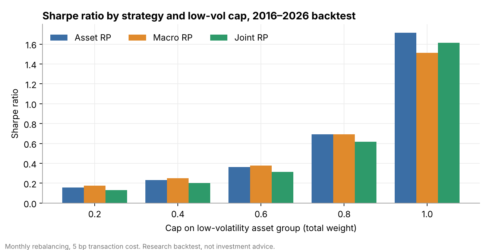
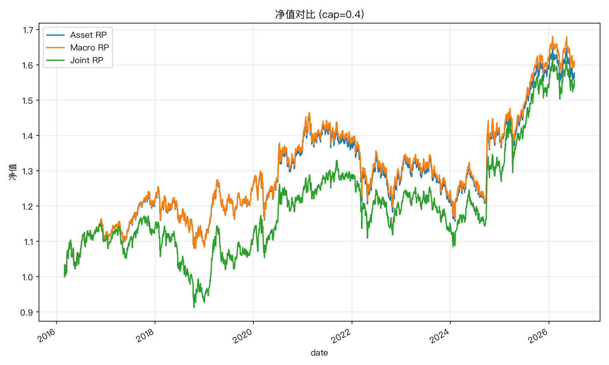

<h1 align="center">Macro Shock Risk Parity</h1>

<p align="center">
  <i>A multi-asset risk-parity backtest in which macroeconomic shocks, extracted with a Kalman filter, drive the covariance matrix.</i>
</p>

<p align="center">
  
  
  
  
</p>

---

## At a glance

| | |
|---|---|
| **Universe** | CSI 300, CSI 500, HSI, S&P 500, Chinese government and credit bonds, convertibles, gold, commodities |
| **Method** | Six-dimension macro factor basis → Kalman-filter shock extraction → factor-implied covariance → equal-risk-contribution solver |
| **Strategies** | **Asset RP** (sample covariance) · **Macro RP** (macro-implied covariance) · **Joint RP** (blend of the two, with weight smoothing) |
| **Backtest** | 2016–2026, month-end decision with rebalance on the next trading day, 5 bp transaction cost, strict no-look-ahead |

<p align="center"></p>

## Key findings

The interesting result here is a diagnosis rather than a headline return. Across the full 2016–2026 sample, **Joint RP had the lowest Sharpe ratio at almost every cap level**. That raised an obvious question: was this a data bug or a real effect? Three controlled experiments, each changing one variable on the same cached data, answered it:

1. **Weight smoothing causes the gap.** With smoothing switched off (`SMOOTHING_LAMBDA` 0.2 → 1.0), Joint RP lands between Asset RP and Macro RP at every cap. Smoothing halves turnover, but the cost of lagging behind the target weights across repeated trend reversals is much larger than the transaction costs it saves.
2. **The ranking reverses with the regime.** Over the most recent two years, Joint RP had the **highest** Sharpe at every cap ≤ 0.8, with about +4% annual excess return over Asset RP in both 2025 and 2026.
3. **An uncapped low-vol group removes the benefit.** At cap = 1.0 the solver concentrates the portfolio in one or two low-volatility bonds. The covariance differences then have nowhere to act, and smoothing becomes pure drag.

**Takeaway:** Joint RP depends on the regime and the constraint, so it is not a stable source of alpha. The full write-up is in [`references/joint_rp_diagnosis_notes.md`](references/joint_rp_diagnosis_notes.md).

<details>
<summary><b>Net asset value, cap = 0.4 (full sample)</b></summary>
<p align="center"></p>
</details>

## Quick start

```bash
pip install -r requirements.txt
cd scripts
python main.py
```

On the first run, all market and macro data is fetched through [akshare](https://github.com/akfamily/akshare) (free, public sources) and cached under `scripts/cache/`. No data files are bundled in this repo. Outputs (a performance table and charts) are written to `scripts/output/`. If the repo is checked out read-only, set `MSRP_CACHE_DIR` / `MSRP_OUTPUT_DIR` to writable locations.

Last verified with akshare 1.18.64.

## Project layout

```
scripts/
  config.py           # asset universe, macro groups, all tunable parameters
  data.py             # akshare fetch + local CSV cache
  macro_factors.py    # publication-lag-aware z-scores + within-group orthogonalisation
  shocks.py           # Kalman-filter shock extraction
  risk_parity.py      # risk-parity solver + covariance construction
  backtest.py         # rebalancing simulation, performance and plots
  main.py             # entry point
references/
  joint_rp_diagnosis_notes.md   # worked example: diagnosing a Sharpe gap across strategies and caps
SKILL.md              # pipeline description, parameters and known behaviour
```

## Use as a Claude Code skill

This repo also ships a `SKILL.md`, so it can be cloned into a Claude Code skills directory:

```bash
git clone https://github.com/Xiewy21/MacroShockRiskParity ~/.claude/skills/macro-shock-risk-parity
```

## Methodology reference

The six-dimension macro shock overlay and the risk-parity blending approach are based on the following CICC (中金公司) research report:

> 陈宜筠, CFA (SAC S0080524080004 / SFC BTZ190); 周萧潇 (SAC S0080521010006 /
> SFC BRA090); 刘均伟 (SAC S0080520120002 / SFC BQR365). 《量化配置模型（3）：
> 如何应对低利率环境——基于宏观冲击的风险平价模型增强》. CICC Research,
> published 2026-06-23.

This repo is an independent reimplementation of the general approach described in the report's public summary. No original report text, tables or charts are reproduced here, and none of the implementation choices should be attributed to the report's authors. A Chinese-language version of the code is available at [zhongjin-rp](https://github.com/Xiewy21/zhongjin-rp).

## Disclaimer

Research code for educational and personal use. Not investment advice. No warranty on data correctness or backtest performance.
